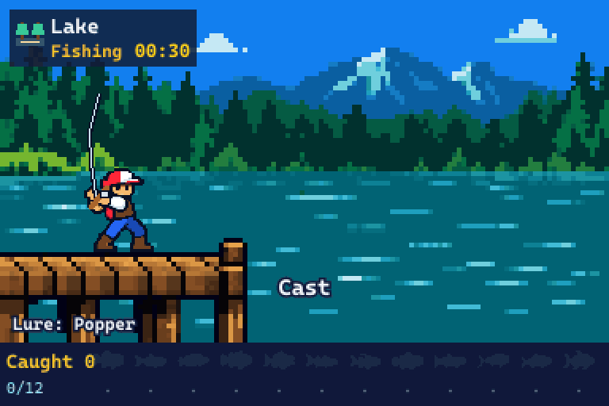

# pixel-fishing

**Claude works. Your 8-bit angler goes fishing.**

[繁體中文](README.zh-TW.md)

A side pane plugin for Claude Code (`pixel-fishing`). Send a prompt and your angler casts, retrieves, and works a lure. When Claude finishes answering, the cast ends with a catch or an empty line. A catch plays out automatically: hookset, fight, landing net, catch card, and release. Interrupt the turn and the fish gets away.

Rotate between a lake, the coast, and a boat. Choose from six lures, collect 18 fish species, and set separate records for your longest and heaviest catches. Longer turns improve your chances of larger and rarer fish.



The animation uses the game's own renderer and shows three successful example trips, with excerpts from longer working periods. See the [English asset overview](fishing-mod-assets-v1/overview.en.png) for all sprites, or download the [full asset pack](fishing-mod-assets-v1.zip) and open its `preview.html`. The asset preview currently has Traditional Chinese labels.

## Install

Requires Claude Code with mod side pane support. The in-session install command below requires **2.1.275 or later**; the shell command with `--marketplace` requires **2.1.292 or later**.

At the prompt of a Claude Code terminal session:

```text
/plugin install pixel-fishing --marketplace s7788/pixel-fishing
```

Confirm adding the marketplace, then choose an installation scope. If Claude Code asks you to reload the plugin, follow its instructions.

Or install from PowerShell or another shell:

```bash
claude plugin install pixel-fishing --marketplace s7788/pixel-fishing
```

After installing from a shell, start a new Claude Code session or run `/reload-plugins` in an existing one. See the [official installation guide](https://code.claude.com/docs/en/discover-plugins) for details.

If you have already added this marketplace, you can also install by its full plugin name:

```bash
claude plugin install pixel-fishing@pixel-fishing
```

### Your first cast

1. The **pixel-fishing** pane opens automatically when a session starts with the plugin loaded. You can also open it with `/pixel-fishing`.
2. Pick a lure below the scene, or leave the default **Random** selection.
3. Send Claude a prompt as usual. Your angler starts fishing, and the catch is decided when Claude finishes answering.
4. Expand **Dex** to see discovered species, catch counts, and records.

To try it without a Claude turn, run `/pixel-fishing-demo` to cast, wait a while, then run it again to reel in.

**Display and language:** Surfaces with `Svg` support show the pixel art scene. The terminal currently shows text status, catch statistics, and the fish collection. The game checks Claude's `language` setting first, then the system locale if no language is set. It uses Traditional Chinese for Traditional Chinese settings and English for other languages.

## How it plays

- **One main turn, one fishing trip.** A prompt starts the trip; a normal answer decides the catch. An interruption or error loses the fish. Subagent turns do not affect your trip.
- **Choose a spot or rotate automatically.** Pick Lake, Coast, or Boat between turns to stay at that spot. Auto rotate follows Lake → coast → boat → lake. On shore, your angler casts, retrieves, and twitches the lure. On the boat, it drops a jig vertically and works it up and down.
- **Choose a lure between turns.** There are six lures plus **Random**; the picker shows lures available at the current spot, with a hint listing the species that favor the tied lure. You cannot change lures during a cast. If your selection does not fit the next spot, the game uses that spot's default lure. Random picks from the available lures each trip.
- **Time affects the catch.** Longer turns reduce the chance of an empty cast and improve the odds of rarer species and larger sizes. The underwater shadow grows with the time tier; it is a hint about the tier, not the species. The species is drawn when the turn ends.
- **Relax between casts.** After five idle seconds, the angler randomly repairs tackle, grills a fish by a shore campfire, or sits and daydreams, with two-second standing breaks and no consecutive repeated activities. There are no campfires on the boat. A new turn starts fishing immediately. These are cosmetic activities and do not change catches or records.
- **Small surprises by the water.** Fish shadows occasionally approach the lure before turning away. Dragonflies visit the lake, crabs cross the coast, and distant dolphins leap beside the boat. Each 32-second window schedules a five-second event at a random offset; visitors also appear while idle. Probing shadows do not guarantee a bite. Events do not affect catch odds and stop immediately on a bite or interruption.
- **Build your collection and records.** Undiscovered fish appear as silhouettes. Discovered entries show the species, catch count, longest length, and heaviest weight. Records are kept per species and across all catches. Length and weight records can belong to different fish.
- **Catches are released automatically.** The fight, netting, and release are animations. The catch is recorded as soon as the turn ends, so sending another prompt immediately does not lose it.

### Spots, lures, and fish

| Spot | Available lures (default first) | Fish |
|---|---|---|
| Lake | Minnow, Popper, Pencil, Soft Worm | Largemouth Bass, Topmouth Culter, Striped Snakehead, Peacock Bass★, Rainbow Trout, Mandarin Fish★ |
| Coast | Minnow, Popper, Pencil, Shore Jig | Spotted Seabass, Great Barracuda, Indo-Pacific Tarpon, Malabar Grouper★, Black Porgy, Giant Trevally★ |
| Boat | Boat Jig | Spanish Mackerel, Mahi-mahi, Greater Amberjack, Yellowfin Tuna★, Red Seabream, Dogtooth Tuna★ |

Each spot has two common species, two uncommon species, and two rare species (★). Lake and coast species favor one or two lures; a favored lure doubles that species' selection weight. All boat species use the Boat Jig. Fish pools and sizes are game settings.

| Claude main turn duration | Chance of an empty cast |
|---|---|
| Under 30 seconds | 30% |
| 30 seconds to under 2 minutes | 10% |
| 2 minutes to under 5 minutes | 4% |
| 5 minutes or longer | 2% |

Turns under 30 seconds cannot draw rare fish. Other tiers use weighted draws based on the spot and lure. Empty-cast probabilities apply only after a normal answer; an interruption or error loses the fish directly.

## Commands

| Command | What it does |
|---|---|
| `/pixel-fishing` | Opens the fishing pane; it also opens automatically at session start |
| `/pixel-fishing-demo` | Starts a fishing trip without a Claude prompt; run it again to reel in and decide the catch |

## Saves and runtime

- **Fishing runs locally.** The game updates eight times a second, makes no model calls, and sends no network requests. It does not call a model to decide your catch. Your normal Claude work is billed as usual.
- **Progress survives sessions.** The collection, catch counts, lure selection, and length/weight records live in the plugin's own store. Sessions share one angler. The chosen spot is saved too; older saves default to Auto rotate and retain their collection and records.
- **Reopening returns you to idle.** If you close a session during a cast, reopening does not resume that trip or count it as a lost fish. Saved catch records remain.

## Updates and troubleshooting

### How do I update?

From PowerShell or another shell:

```bash
claude plugin marketplace update pixel-fishing
claude plugin update pixel-fishing@pixel-fishing
```

Restart Claude Code afterward to load the new version.

### Switching from an earlier installation

Version 0.2.0 uses `pixel-fishing` as the plugin name and `/pixel-fishing` and `/pixel-fishing-demo` as its commands. Disable the previous fishing plugin in `/plugin` before installing this version, so only one fishing plugin handles each turn. The new plugin identity uses its own store; records from an earlier identity are not transferred automatically. Keep the previous installation's data if you want to retain those records.

### The pane did not appear after installation

Try `/pixel-fishing`. If the command is missing, run `/plugin`, check that `pixel-fishing` is installed and enabled, then follow the reload instructions or start a new session. The terminal currently shows text only; pixel art requires a host surface with `Svg` support.

### Why did I catch nothing, or why did my lure change?

A normal answer can still end with an empty cast. Interruptions and errors lose the fish. In Auto rotate, each trip moves to the next spot, and an incompatible lure is replaced with that spot's default. The boat, for example, only uses the Boat Jig.

### Why is the spot stuck after an update?

Check that Auto rotate is selected. Version 0.2.2 fixes hot reload retaining older live state without `venueChoice`, which could prevent spot rotation. Loading the update fills and saves missing fields while preserving the current cast and records. On earlier versions, start a new session or select Auto rotate after the turn ends.

## Contributing

Open a shell in the repository root to load a local copy:

```bash
claude --plugin-dir .
```

Run checks from the repository root:

```bash
claude plugin validate .
claude plugin test .
```

`hooks/gen/*.ts` is generated by `node tools/gen-sprites.cjs` from the asset pack's `pixel-data.json` and `manifest.json`. Regenerate these files after changing assets; do not edit the generated output by hand.

To rebuild both README animations, install the development dependencies with `npm install`, make sure `ffmpeg` is on your PATH, then run:

```bash
npm run build:demo
```

This runs the game engine and SVG renderer with deterministic example casts and writes the English and Traditional Chinese GIFs to `docs/media`. It does not access player saves or call Claude.

## Asset pack and preview

The original asset pack includes **252 game PNGs** covering three layered fishing spots, 12 fish species, nine angler animations, six lures, tackle, effects, and record UI. It also includes source images, atlases, animation sequences, anchors, and RLE pixel data.

The game adds six native pixel fish designs and seated idle poses, tackle, and campfire props in `hooks/extras.ts`; these additions are separate from the original downloadable pack.

- [Download the full asset pack ZIP](fishing-mod-assets-v1.zip)
- [Asset usage guide (Traditional Chinese)](fishing-mod-assets-v1/README.zh-TW.md)
- [Dimensions, frames, and anchors](fishing-mod-assets-v1/manifest.json)
- [Asset validation results](fishing-mod-assets-v1/validation.json)

After downloading, open `fishing-mod-assets-v1/preview.html` to switch spots, angler actions, and species. This is an asset demonstration. GitHub's source viewer does not run the preview page.

For a local preview server or asset checks, install **Node.js 20.9 or later** and run from the repository root:

```bash
npm install
npm run preview
```

Open the local URL printed in your terminal. To validate the assets:

```bash
npm run validate:assets
```

The main canvas is **384×216**. Background layers are **128×72**, scaled by an integer factor of three. Fish names, weights, lengths, and record markers are drawn at runtime. See the asset usage guide for integration details.

Images were generated with image_gen, then cropped, palette-adjusted, aligned to the pixel grid, and checked for transparency. Rods and simple UI use integer-pixel drawing. Generation prompts and style references are included in the asset pack.

## License

Source code and textual documentation are licensed under [MIT](LICENSE). Pixel artwork is reserved, including sprites, scenes, encoded pixel data, preview images, and demo media. The artwork is provided for use with pixel-fishing; reuse or redistribution in another project requires separate permission. See [NOTICE](NOTICE) and the [asset license](fishing-mod-assets-v1/LICENSE.assets.txt).

## Support

pixel-fishing is an original project by s7788. If you enjoy it, you can [buy the author a coffee on PayPal](https://www.paypal.me/s7788pixel) to support further development.
