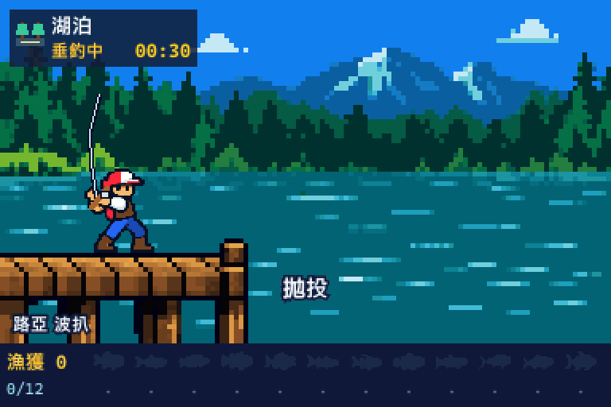

# pixel-fishing

[English](README.md) | 繁體中文

**Claude 在工作，你的 8-bit 釣手在釣魚。**

Claude Code 的側邊面板外掛（`pixel-fishing`）。你送出提示，釣手就拋竿、收線、操作路亞；Claude 回答完，這一竿會釣到魚或空軍。釣到魚後，自動演出作合、搏魚、抄網上岸、展示漁獲與放流。中斷回合則脫鉤。

在湖泊、海岸與船上輪流下竿，搭配六種路亞，收集 18 種魚的圖鑑，刷新最長與最重紀錄。回合越長，越有機會釣到大魚與稀有魚。



動圖直接使用遊戲繪圖程式，展示三趟成功釣獲的範例，較長回合的操作時間採片段呈現。完整素材可看[繁中總覽圖](fishing-mod-assets-v1/overview.png)，或下載[完整素材包](fishing-mod-assets-v1.zip)，開啟其中的 `preview.html` 檢視場景與動作。

## 安裝

需要支援 mod 側邊面板的 Claude Code。以下 session 安裝指令需要 **2.1.275 以上**；shell 的 `--marketplace` 安裝方式需要 **2.1.292 以上**。

在 Claude Code 終端機 session 的提示列輸入：

```text
/plugin install pixel-fishing --marketplace s7788/pixel-fishing
```

依提示確認新增 marketplace，再選擇安裝範圍。若安裝後提示需要重新載入，依提示操作。

也可以從 PowerShell 或其他 shell 安裝：

```bash
claude plugin install pixel-fishing --marketplace s7788/pixel-fishing
```

從 shell 安裝後，開啟新的 Claude Code session，或在已開啟的 session 執行 `/reload-plugins`。安裝流程詳見 [Claude Code 官方說明](https://code.claude.com/docs/en/discover-plugins)。

若已經加入過這個 marketplace，也可以直接使用完整外掛名稱安裝：

```bash
claude plugin install pixel-fishing@pixel-fishing
```

### 開始第一趟釣行

1. 外掛載入後會在 session 開始時自動開啟 **pixel-fishing** 面板；也可以輸入 `/pixel-fishing` 開啟。
2. 在面板下方選擇路亞，或保留預設的「隨機」。
3. 照常送出提示給 Claude，釣手會自動開始釣魚，等 Claude 回答完再結算。
4. 展開「圖鑑」，查看已釣到的魚種、數量與紀錄。

想先試玩，可以輸入 `/pixel-fishing-demo` 拋竿，等一段時間後再輸入一次收竿。

**畫面與語言：** 支援像素畫面的介面顯示釣魚場景；終端機目前顯示文字狀態、漁獲統計與圖鑑。遊戲先讀取 Claude 的 `language` 設定，未設定時再看系統地區；繁體中文顯示中文，其他語言顯示英文。

## 玩法

- **一個主回合就是一趟下竿。** 送出提示開始，正常回答時結算；中斷或錯誤則脫鉤。子代理的回合不影響釣行。
- **選擇釣場或自動輪替。** 回合之間可選湖泊、海岸或船上並固定在該處；「自動輪換」則依湖泊 → 海岸 → 船上輪替。岸邊反覆拋投、收線與抽竿；船上改為垂直放餌與鐵板抽動。
- **回合之間選路亞。** 六種路亞加上「隨機」，選單只顯示目前場地可用的路亞，並提示偏好目前路亞的魚種；下竿期間不能更換。若選擇不適用於下一個釣場的路亞，會自動換成該場的預設路亞；隨機則每趟從該場可用路亞中抽選。
- **等待時間影響漁獲。** 回合越長，空軍機率越低，抽到稀有魚與較大尺寸的機會也越高；水下魚影會隨時間變大。魚影是時間級別的提示，魚種在回合結束時才決定。
- **收集圖鑑與紀錄。** 未釣到的魚顯示剪影；解鎖後可查看魚種、累積數量、最長與最重紀錄。每種魚及全體漁獲都分別保存長度與重量紀錄，可以來自不同的魚。
- **閒置時也有生活感。** 待機 5 秒後，每 10 秒輪流修理釣具、營火烤魚、坐著發呆；船上以發呆取代營火。新回合開始便立即拋竿。閒置動作為情境演出，不消耗漁獲或變更紀錄。
- **結算後自動放流。** 搏魚、抄網與放流自動演出；漁獲在回合結束時就已記錄，立刻送出下一個提示也不會漏記。

### 釣場、路亞與魚種

| 釣場 | 可用路亞（第一種為預設） | 魚種 |
|---|---|---|
| 湖泊 | 米諾、波扒、鉛筆、軟蟲 | 大口黑鱸、翹嘴鮊、線鱧、孔雀鱸★、虹鱒、鱖魚★ |
| 海岸 | 米諾、波扒、鉛筆、岸拋鐵板 | 花鱸、大梭魚、大眼海鰱、點帶石斑魚★、黑鯛、浪人鰺★ |
| 船上 | 船釣鐵板 | 土魠、鬼頭刀、紅甘、黃鰭鮪★、真鯛、犬齒鮪★ |

每場有 2 種普通魚、2 種少見魚與 2 種稀有魚（★）。湖泊與海岸的每種魚各偏好一至兩種路亞，使用偏好路亞會讓該魚的抽選權重加倍；船上魚種皆使用船釣鐵板。魚池與尺寸為遊戲設定。

| Claude 主回合時長 | 空軍機率 |
|---|---|
| 少於 30 秒 | 30% |
| 30 秒至未滿 2 分鐘 | 10% |
| 2 分鐘至未滿 5 分鐘 | 4% |
| 5 分鐘以上 | 2% |

少於 30 秒的回合不會抽到稀有魚；其餘級別仍依釣場與路亞加權抽選。空軍機率只適用於正常回答後的結算，中斷或錯誤會直接脫鉤。

## 指令

| 指令 | 用途 |
|---|---|
| `/pixel-fishing` | 開啟釣魚面板；session 開始時也會自動開啟 |
| `/pixel-fishing-demo` | 不送出 Claude 提示，手動開始一趟釣行；再次執行時收竿結算 |

## 存檔與執行方式

- **釣魚邏輯在本機執行。** 每秒更新 8 次，不呼叫模型、不發出網路請求，也不額外呼叫模型來決定漁獲；你原本交給 Claude 的工作照常計費。
- **跨 session 保留紀錄。** 圖鑑、漁獲數量、路亞選擇及長度／重量紀錄保存在外掛自己的 store，所有 session 共用一位釣手。
- **重新開啟時回到待機。** 若上次在下竿途中關閉 session，重開後不會延續該趟釣行，也不會把它計為脫鉤；已保存的漁獲紀錄仍保留。

## 更新與常見問題

### 如何更新？

在 PowerShell 或其他 shell 執行：

```bash
claude plugin marketplace update pixel-fishing
claude plugin update pixel-fishing@pixel-fishing
```

完成後重新啟動 Claude Code，載入新版本。

### 從先前的安裝切換

0.2.0 版統一使用 `pixel-fishing` 作為外掛名稱，指令為 `/pixel-fishing` 與 `/pixel-fishing-demo`。安裝本版前，請先在 `/plugin` 停用原本的釣魚外掛，避免兩個外掛同時處理回合。新的外掛識別使用獨立存檔，先前識別下的紀錄不會自動轉入；若要保留那些紀錄，請保留原安裝的資料。

### 安裝後沒有看到面板？

先輸入 `/pixel-fishing`。若找不到指令，執行 `/plugin`，確認 `pixel-fishing` 已安裝並啟用，再依提示重新載入外掛或開啟新的 session。終端機目前只顯示文字介面；像素場景需要宿主介面支援 `Svg` 元件。

### 為什麼沒釣到魚，或路亞自己換了？

正常回答後仍有機會空軍；回合中斷或發生錯誤則脫鉤。選擇「自動輪換」時，每趟會換到下一個釣場，不適用的路亞也會換成該場預設路亞；例如船上只使用船釣鐵板。

### 更新後釣場一直停在同一處？

先確認釣場選擇是「自動輪換」。0.2.2 修正了熱重載保留舊狀態、缺少 `venueChoice` 時無法換場的問題；載入新版時會補齊欄位並保存，保留目前釣行與紀錄。舊版可先開新 session，或在回合結束後點選「自動輪換」。

## 參與開發

在 repo 根目錄開啟 shell，本機載入外掛：

```bash
claude --plugin-dir .
```

在 repo 根目錄執行檢查：

```bash
claude plugin validate .
claude plugin test .
```

`hooks/gen/*.ts` 由 `node tools/gen-sprites.cjs` 從素材包的 `pixel-data.json` 與 `manifest.json` 產生。更新素材後請重新產生，不要手改產出檔。設計決策與檔案地圖見 [HANDOFF.md](HANDOFF.md)。

若要重建兩種語言的 README 動圖，先執行 `npm install` 安裝開發依賴，確認 PATH 中有 `ffmpeg`，再執行：

```bash
npm run build:demo
```

程式會用固定的範例下竿執行遊戲狀態機與 SVG 繪圖，將英文、繁中 GIF 輸出至 `docs/media`，不讀取玩家存檔，也不呼叫 Claude。

## 素材包與預覽

原始素材包附有 **252 張遊戲用 PNG**，包含三個分層釣場、12 種魚、9 組釣手動作、六種路亞、釣具、特效與紀錄介面；另附生成母圖、圖集、動畫順序、錨點與 RLE 像素資料。

遊戲另於 `hooks/extras.ts` 加入六種原生像素魚圖、坐姿、釣具與營火道具，這些擴充不包含在原始素材包下載檔中。

- [下載完整素材包 ZIP](fishing-mod-assets-v1.zip)
- [素材使用說明](fishing-mod-assets-v1/README.zh-TW.md)
- [尺寸、影格與錨點資料](fishing-mod-assets-v1/manifest.json)
- [素材檢查結果](fishing-mod-assets-v1/validation.json)

下載後可直接開啟 `fishing-mod-assets-v1/preview.html`，切換場地、釣手動作與魚種。這是素材預覽，GitHub 原始碼頁面不會直接執行它。

如需本機預覽伺服器或素材檢查，安裝 **Node.js 20.9 以上**，在 repo 根目錄執行：

```bash
npm install
npm run preview
```

開啟終端顯示的本機網址。檢查素材則執行：

```bash
npm run validate:assets
```

主畫布為 **384×216**；背景原生 **128×72**，以整數 3 倍顯示。魚名、重量、長度與紀錄標記由程式動態繪製，詳細接入規格見素材使用說明。

圖片由內建 image_gen 生成，再經切圖、調色、像素對齊與透明度檢查；釣竿和簡單介面採整數像素繪製。生成提示詞與風格參考保存在素材包內。

## 授權

程式碼與文字文件採 [MIT 授權](LICENSE)。像素素材保留權利，包括角色、場景、編碼像素資料、預覽圖與展示媒體；素材提供於 pixel-fishing 使用，若要在其他專案重用或重新散布，需另取得作者許可。詳見 [NOTICE](NOTICE) 與[素材授權](fishing-mod-assets-v1/LICENSE.assets.txt)。

## 贊助

pixel-fishing 是 s7788 的原創作品。如果你喜歡這個小遊戲，歡迎透過 [PayPal 請作者喝杯咖啡](https://www.paypal.me/s7788pixel)，支持後續開發。
